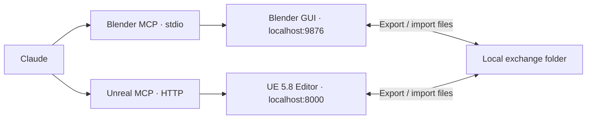

# Hollowpurple Unreal

Connect **Claude → Epic's native Unreal Engine 5.8 MCP**, alongside the [Blender setup](https://github.com/neoisone/hollowpurple). Use Blender for modeling/rigging and Unreal for scene assembly, lighting, Niagara, Sequencer and rendering. Claude orchestrates both apps through separate MCP connections.

This repository supplies Python setup, connection checks and static-mesh transfer helpers. The Unreal MCP server itself ships with **UE 5.8**; this is not a replacement server or an Epic product. Epic marks its MCP feature **Experimental**. This setup deliberately rejects **5.7.4**. Install 5.8 alongside it and create a new project or open a copy in 5.8; keep the original project intact.



## Windows setup

Install **Unreal Engine 5.8 through Epic Games Launcher**, a current NVIDIA driver, Git, uv and your chosen Claude client. The setup does not download Unreal. No custom C++ plugin or Visual Studio compilation is required for this connection in a Launcher installation. Unreal uses its own embedded Python; do not install `unreal` or `bpy` into this repository's environment.

```powershell
winget install --id astral-sh.uv -e
winget install --id Git.Git -e
```

Reopen PowerShell. Create a **new UE 5.8 project**, open it once, save it, then close Unreal. Close Claude Desktop too if that is your client. Use the actual paths on your machine:

```powershell
git clone https://github.com/neoisone/hollowpurple-unreal.git
cd hollowpurple-unreal
uv sync --frozen --python 3.11

$UE = "C:\Program Files\Epic Games\UE_5.8"
$ProjectFile = "C:\UnrealProjects\Hollowpurple\Hollowpurple.uproject"

# Inspect; no project or client files are written.
uv run --frozen python -m pipeline.setup --engine "$UE" --project "$ProjectFile" --client code --usd

# Apply after reviewing the printed file paths. Existing files are backed up.
uv run --frozen python -m pipeline.setup --engine "$UE" --project "$ProjectFile" --client code --usd --apply
```

Use **`--client desktop` in both commands** for Claude Desktop. `--usd` is optional: it also enables the USD Importer for scene interchange. Both modes enable `ModelContextProtocol`, `AllToolsets`, `PythonScriptPlugin` and `EditorScriptingUtilities`. Engine `Build.version`, project association, plugin availability and configuration conflicts are checked before any writes.

The installer preserves unrelated fields, plugin settings and MCP servers, including `blender`. Existing UTF-8/UTF-16 INI encoding, BOM and Windows line endings are preserved. It refuses a different existing `unreal-mcp` entry unless you deliberately supply `--replace-existing`. It never stops applications. Config backups use timestamped `.bak` names beside the original files.

### Claude Code

The setup merges an HTTP `unreal-mcp` entry into **`.mcp.json` beside the `.uproject`**. Start Claude Code from that project folder and approve the project MCP server when prompted. A Blender server configured at user scope by `hollowpurple` stays available.

Alternatively, launch from a different folder with the actual configuration path:

```powershell
claude --mcp-config "C:\UnrealProjects\Hollowpurple\.mcp.json"
```

Use `--config` during setup if you deliberately want a different JSON file. Do not use `--strict-mcp-config` if you want the existing user-scope Blender connection too. This helper targets **Launcher projects with `EngineAssociation: "5.8"`**; it does not rewrite custom source-build GUID associations.

Epic also publishes a Claude Code skill plugin. Inside Claude Code:

```text
/plugin install unreal-engine-skills-for-claude-code@claude-plugins-official
```

Its session-start hook needs Bash. Git for Windows supplies Git Bash; verify `bash --version` if you want that hook. Native Windows MCP connections do not need WSL or the hook. This skill plugin teaches tool use; it does not install the engine or enable the project plugins.

### Claude Desktop

The default configuration is `%APPDATA%\Claude\claude_desktop_config.json`. The installer adds **only** `unreal-mcp`, preserving the Blender entry. A pinned `mcp-proxy==0.13.0` process translates Desktop's stdio connection to Unreal's local Streamable HTTP endpoint. Its launcher uses this repo's absolute path and frozen environment, so keep the checkout in place and rerun setup if you move it.

This is the local Desktop configuration, not a cloud connector to localhost. Open Unreal before restarting Desktop. After Unreal restarts, reconnect the MCP server or fully restart Desktop if its tools are stale. The proxy does not make an offline editor available. Do not install a second Unreal proxy beside this connection.

## Open and verify

1. Open the selected `.uproject` in **UE 5.8**. Let compilation/loading finish.
2. In Unreal's **Output Log**, confirm MCP startup. If necessary, run this in its **Cmd** console, not Python mode:

```text
ModelContextProtocol.StartServer
```

3. From this repository, run a real MCP handshake and tool catalog query:

```powershell
uv run --frozen python -m pipeline.check
```

4. Restart the chosen Claude client. In Claude Code, `/mcp` should show **both** `blender` and `unreal-mcp`. Ask it to inspect both applications before creating anything. Desktop users can attach `CLAUDE.md` and `docs/INTERCHANGE.md` to the conversation, then paste the starter prompt in `CLAUDE.md` with the actual repo/project paths.

The check proves HTTP negotiation and live catalog discovery, not imports or image quality. For further verification, discover a read-only tool in Claude and call it against the current level. `pipeline.check --read-tool call_tool --arguments '<JSON>'` can repeat that call with its **actual discovered schema**. Do not guess tool names or arguments.

Unreal's tool-search mode normally advertises **three** meta-tools: `list_toolsets`, `describe_toolset`, `call_tool`. That is expected. Enable `AllToolsets` if discovery is empty. Serialize editor calls, especially mutations.

For a port conflict, choose another unused port without stopping another process. Rerun setup with, for example, `--port 8123`, then use `pipeline.check --url http://127.0.0.1:8123/mcp`. Keep the server on loopback: it has no authentication. Explicit non-loopback HTTP binds in project `Config` and `Saved/Config` are rejected; also inspect any engine/global listener overrides on the target machine.

## Use assets in either application

[Interchange guide](docs/INTERCHANGE.md) covers the two directions, generated Python scripts, unit/axis checks, FBX/USD/Alembic choices, and shader/simulation limitations. The included automation handles **one static mesh per transfer**. Skeletal animation and whole-scene interchange need task-specific settings and inspection.

```powershell
# Creates a fresh transfer directory with source.py, target.py and job.json.
uv run --frozen python -m pipeline.exchange prepare --direction blender-to-unreal --exchange "C:\HollowpurpleExchange" --name SM_Cube --source Cube

# After Claude runs source.py through the source application's MCP:
uv run --frozen python -m pipeline.exchange verify "C:\HollowpurpleExchange\<printed-job-directory>"
```

Run `target.py` through the destination application's Python tool after verification. Reverse the direction with `--direction unreal-to-blender --source /Game/Props/SM_Cube.SM_Cube`. The scripts export/import files; they do not save the live scene or publish assets automatically.

Unreal's renderer on the RTX 4090 is configured in Unreal (DirectX 12, relevant ray tracing/render settings). **OptiX is the separate Blender Cycles setting**, not an Unreal setting. Neither a connection nor a GPU setting proves quality: inspect a small render before a full sequence.

## Checks and limits

```powershell
uv run --frozen python -m unittest discover -s tests -v
```

CI runs the tests on Windows and Linux. Tests cover configuration preservation/backups, conflicts, rollback, transfer manifests, a real HTTP MCP fixture and the Desktop stdio proxy. The fixture is **not Unreal**. A Blender 5.2.2 background export/import smoke test was run on macOS and preserved a 2 m cube's dimensions. The optional smoke script in `tests/blender_exchange_smoke.py` creates a new background scene; never run it inside a working live project.

**Not verified here:** live UE 5.8 tool schemas/import/export, the target Windows installation, Claude UI policies, RTX 4090 rendering and a complete Blender→Unreal→Blender round trip. Use the acceptance steps in the interchange guide on the target PC. No old scene files, engine binaries, footage, downloaded assets or model weights are included.

See [official sources and troubleshooting](docs/SOURCES_AND_ERRORS.md) and [Claude instructions/starter prompt](CLAUDE.md).
